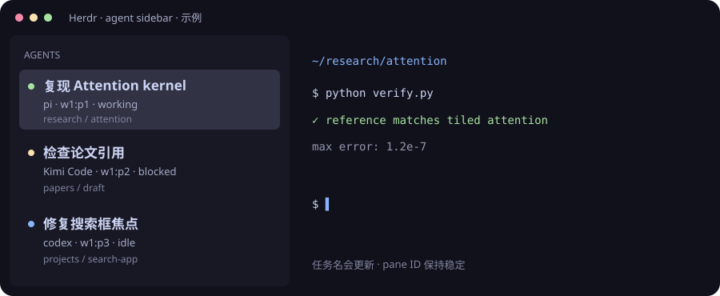

# Herdr Agent Sidebar

[English](README.md) · [简体中文](README.zh-CN.md)

**See which agent is doing what, directly in your sidebar.**

A multi-agent terminal workflow for [Herdr](https://herdr.dev): the task appears on the first line, the agent, stable pane ID, and state on the second, and the directory on the third. Includes Pi task labels, Kimi Code compatibility, event-driven updates, and periodic refresh.

[Installation and removal](docs/installation.md) · [Configuration](docs/configuration.md) · [Troubleshooting](docs/troubleshooting.md)



## Why this exists

When several `codex resume`, Pi, and Kimi sessions are open, an agent or model name rarely tells you what each one is doing. A manually assigned label can also become stale when the conversation changes topic.

This workflow separates the tool from its current task. **A pane ID such as `w1:p1` is a stable address; its task label can update automatically.**

## Features

- **Three-line sidebar:** task → agent / pane ID / state → project directory.
- **Automatic refresh:** updates when panes are created, focused, or moved and when agent state changes. A persistent listener also checks session files every two seconds.
- **Pi session labels:** the basic mode uses the first 36 characters of the latest substantive request from the matching session. It does not assign sessions by file recency alone, reducing cross-session mix-ups without another model call.
- **Pi input extension:** publishes task input and session identity when loaded; existing processes can still use local session matching.
- **Kimi Code compatibility:** optional lifecycle hooks address the `kimi-co` recognition problem in Herdr 0.8.2 and report working, waiting-for-confirmation, and idle states.
- **Manual names take priority:** an explicit pane label is preserved. Clear it to return to automatic naming.
- **Portable installation:** resolves Python, Herdr, and home-directory paths; supports a dry run; backs up existing configuration; and stops uninstall if later edits would be overwritten.

## Quick start

Requires Python **3.11+**, an installed Herdr, and `herdr` available in your terminal.

```sh
git clone https://github.com/APhysickui/herdr-agent-sidebar.git
cd herdr-agent-sidebar

# Preview without changing any files
python3 install.py --with-pi --with-claude --auto-tabs --dry-run

# Install the sidebar, input capture, and macOS realtime listener
python3 install.py --with-pi --with-claude --auto-tabs
```

If **Kimi Code disappears from Herdr or shows `unknown`**, read the [compatibility notes](docs/troubleshooting.md#kimi-code-不显示) before adding `--with-kimi`. Existing official Kimi/Herdr hooks must be migrated first so two sources do not compete for the same state.

```sh
python3 install.py --with-pi --with-claude --auto-tabs --with-kimi
```

The original compatibility setup was verified on **macOS, Herdr 0.8.2, and Kimi Code 2.1.1**. Realtime naming has also been verified with **Herdr 0.9.5**. Linux supports event-plugin installation; automatic background-service setup currently generates a macOS LaunchAgent. CI checks Python logic and isolated installation on Linux and macOS, rather than claiming every terminal version has been tested live.

## Everyday use

```sh
# Refresh manually
herdr plugin action invoke community.agent-sidebar.refresh

# Pin an explicit task name
herdr pane rename w1:p1 'Check paper equations'

# Return to automatic naming when the task changes
herdr pane rename w1:p1 --clear
```

With Herdr's default keybindings, press the prefix and then `Shift+P` to rename the current pane. The default prefix is `Ctrl+B`; use `Ctrl+A` instead if that is your configured prefix.

Name tabs after projects and panes after tasks. Choose `spaces` for grouped ordering or `priority` to surface agents needing attention. The installer preserves your existing sort preference.

## Limits of automatic labels

Basic labels are short previews of a request or meaningful terminal title, **not model-generated summaries**. Pi, Codex, and Kimi can use information from their matching local sessions. A generic launcher title such as `codex resume` falls back to the directory when no session can be identified.

An uncertain Pi match is not assigned to another pane. Short acknowledgements such as “okay” or “continue” do not replace a substantive task. Explicit labels remain fixed by design until cleared.

## Development and verification

The runtime uses only the Python standard library. Pi loads its own extension, so no npm dependencies need to be installed here.

```sh
PYTHONPATH=plugin python3 -m unittest discover -s tests -v
python3 -m compileall -q install.py plugin
```

Tests cover multiple Pi sessions in the same directory, task updates, manual-name preservation, Kimi state classification, identity cleanup after exit, configuration merging, repeated installation, and uninstall restoration. GitHub Actions runs the checks as well.

## Privacy and license

Default mode reads pane metadata, limited terminal content, and enabled session files locally. Optional model summaries require explicitly choosing a provider: only the latest task and limited project context are sent, not an entire conversation or files. Generated labels are cached by input hash, and network requests run in the background. Examples in this repository use fictional tasks rather than real conversations.

Apache-2.0; see [LICENSE](LICENSE) and [NOTICE](NOTICE). This is an independent community project, unaffiliated with the official Herdr, Pi, or Kimi teams.

## Realtime pane and tab names

Install with `--auto-tabs` to let tab labels follow their main project. Events are coalesced for 250 ms, with a two-second fallback for session files. Pane and tab labels update in the same pass; unchanged fields are not repeatedly written.

The realtime workflow has been verified with Herdr 0.9.5. Codex uses an exact session ID or a unique match between its terminal footer and local thread name. Kimi reads the current session's `lastPrompt`, avoiding a stale title based on its first request. Explicit pane labels still win; manually renaming an adopted tab pins that tab.

## Optional summaries and shorter tabs

The top bar uses only a short project or topic name, such as “Herdr Sidebar” or “WorkBuddy.” It does not concatenate every task or add opaque `+1` counts. The default limit is 16 terminal cells. Detailed tasks remain visible per pane in the sidebar: for example, a sidebar label can say “History paper review” while the tab says “History.”

```toml
summarize_titles = true
# Set only after authorizing this provider to receive task text.
# An empty value sends no model requests.
summary_provider = "your-pi-provider-name"
summary_model = "deepseek-v4-flash"
```

The adapter reuses the explicitly selected OpenAI-compatible provider in `~/.pi/agent/models.json` without copying its key. It generates and caches labels only when the task changes, keeps the previous summary while a new one is pending, and backs off for five minutes after failure. Without a usable summary, it shows a short project or agent name rather than exposing a long conversational request as the title.

## Pi and Claude input capture

The Pi extension publishes only `live_task` and session identity; it does not overwrite the rendered `task` with the raw prompt. `--with-claude` installs a `UserPromptSubmit` hook. Existing Claude sessions can also be identified through PID-to-session mapping, keeping instances in the same directory separate.

Greeting-only sessions, such as those containing only `hi`, use distinct session labels rather than an invented task. A substantive request then enters the summary workflow. Local `refresh_status` and `summary_status` fields record processing state, without credentials or request bodies.
