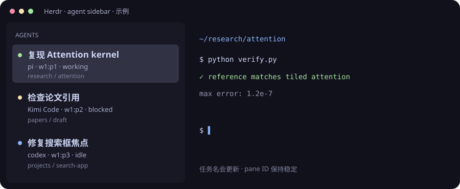

# Herdr Agent Sidebar

**让侧栏告诉你：哪个 agent 正在做什么。**

为 [Herdr](https://herdr.dev) 整理的一套多 agent 终端工作流：任务名放在第一行，agent、稳定 pane ID 和状态放在第二行，目录放在第三行。支持 Pi 自动任务名、Kimi Code 状态兼容，以及事件触发和定时刷新。

[English](README.en.md) · [安装与卸载](docs/installation.md) · [配置](docs/configuration.md) · [故障处理](docs/troubleshooting.md)



## 为什么做这个

同时开几个 `codex resume`、Pi 和 Kimi 时，标签页里的模型名称很难说明任务。手动改一次名字，又容易在换话题后变成旧标签。

这套方案把“用什么工具”和“在做什么”分开显示。**`w1:p1` 这样的 pane ID 是稳定地址；任务名是可以自动更新的标签。**

## 已有功能

- **三行侧栏**：任务名 → agent / pane ID / 状态 → 项目目录。
- **自动刷新**：新建、切换、移动 pane 和 agent 状态变化时刷新；macOS 默认每 60 秒再检查一次。
- **Pi 会话取名**：从对应会话的最近有效提问取前 36 个字符。不按“最近修改的会话文件”猜测，避免两个 Pi 串名；无需额外模型调用。
- **Pi 输入扩展**：扩展加载后，新提问直接发布任务标签；已有进程仍可用本地会话匹配更新。
- **Kimi Code 兼容**：可选的生命周期钩子，处理 Herdr 0.8.2 未识别 `kimi-co` 的情况，显示工作、等待确认和空闲状态。
- **手动命名优先**：明确设置的 pane 名称不会被自动刷新覆盖。清除它即可恢复自动模式。
- **便于迁移**：自动生成 Python、Herdr 和用户目录路径；安装前可预览；保存原配置；卸载遇到后续修改会停止，不覆盖你的编辑。

## 快速开始

需要 Python **3.11+**、已安装的 Herdr，以及终端可用的 `herdr` 命令。

```sh
git clone https://github.com/APhysickui/herdr-agent-sidebar.git
cd herdr-agent-sidebar

# 先预览，不修改文件
python3 install.py --with-pi --dry-run

# 安装侧栏、Pi 自动命名，以及 macOS 的每分钟刷新
python3 install.py --with-pi
```

如果你也遇到了 **Kimi Code 在 Herdr 中消失或 unknown**，阅读[兼容说明](docs/troubleshooting.md#kimi-code-不显示)后再加上 `--with-kimi`。已有官方 Kimi/Herdr 钩子时，安装器会要求先迁移，避免两个状态来源互相覆盖。

```sh
python3 install.py --with-pi --with-kimi
```

**实际验证环境：macOS、Herdr 0.8.2、Kimi Code 2.1.1。** Linux 支持安装事件刷新配置；定时服务目前仅自动生成 macOS LaunchAgent。CI 在 Linux/macOS 上验证 Python 逻辑和隔离安装，不代表所有终端版本都经过实际操作验证。

## 日常用法

```sh
# 手动刷新
herdr plugin action invoke community.agent-sidebar.refresh

# 临时固定一个明确的任务名
herdr pane rename w1:p1 '检查论文公式'

# 换了任务，回到自动命名
herdr pane rename w1:p1 --clear
```

使用 Herdr 默认快捷键时，在当前 pane 按前缀键，再按 `Shift+P` 可以改名。前缀默认是 `Ctrl+B`；如果你自己设为 `Ctrl+A`，就用自己的设置。

建议标签页按项目命名，pane 按任务区分。排序可以选择固定的 `spaces` 或关注待处理项的 `priority`；安装器保留你的排序设置。

## 自动命名的边界

这里的“任务名”是提问或有效终端标题的短预览，**不是额外调用模型生成的摘要**。Pi 可以从本地会话补充信息；其他 agent 如果只提供 `codex resume` 这样的通用标题，会回退到目录。

Pi 匹配不确定时不会把另一段会话硬塞给当前 pane。过短的“好的”“继续”等输入不会替换有效任务名。手动标签固定不变是明确的优先级，清除后才能自动更新。

## 开发与验证

运行时只用 Python 标准库；Pi 扩展由 Pi 自己加载，不需要在这里安装 npm 依赖。

```sh
PYTHONPATH=plugin python3 -m unittest discover -s tests -v
python3 -m compileall -q install.py plugin
```

测试包含同目录多 Pi 会话区分、任务更新、手动名称保护、Kimi 状态识别、退出后的身份清理、配置合并、重复安装和卸载恢复。项目也提供了 GitHub Actions 配置。

## 隐私与许可

运行时读取的信息留在本机：pane 元数据、用于匹配的局部终端画面，以及启用 Pi 后的本地会话文件。任务预览会显示在 Herdr 侧栏中；项目不调用外部模型或上传聊天记录。仓库里的示例使用虚构任务，不包含真实会话。

Apache-2.0，详见 [LICENSE](LICENSE) 和 [NOTICE](NOTICE)。这是独立社区项目，与 Herdr、Pi、Kimi 的官方团队无隶属关系。
