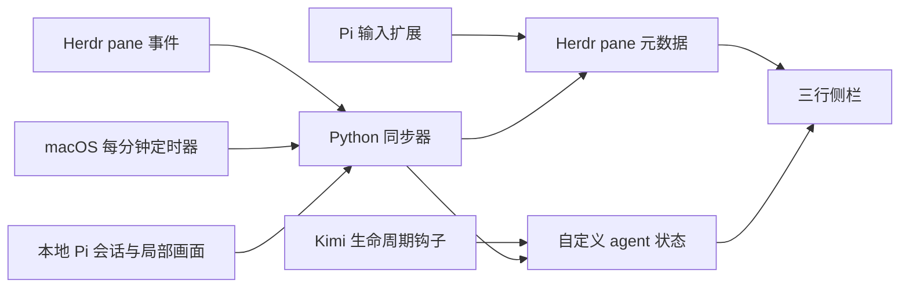

# 运行方式

`plugin/sync.py` 负责布局所需字段和有变化才写入的更新。`live_tasks.py` 提供 Pi 会话匹配，以及可选 Kimi 前景进程检查。`kimi_state.py` 接收生命周期事件，通过 Herdr 的本地 Unix socket 发布状态。Pi TypeScript 扩展也只调用该本地 socket。

安装器使用标准库解析 TOML，针对目标键替换文本，保留其他节与已有 hook。服务文件和插件 manifest 在安装时生成，避免把开发者的 home、Python 或可执行文件路径分发给别人。

运行时不调用 GitHub、Composio 或外部模型；这些工具不属于项目依赖。仓库中的 CI 只跑合成数据和隔离临时目录测试，不需要真实 agent、账号、密钥或聊天记录。
